# Docsy 1.1.1 候选版代码复审

日期：2026-10-19  
审阅对象：当前工作树的 1.1.1 候选代码（`HEAD` = `8746760` / v1.0.10，其上叠加未提交的 1.1.1 变更）  
审阅方式：固定快照 + 分域静态审查 + 自动化测试 + 实际页面截图 + qpdf 行为实验  
结论：**不建议直接发布 1.1.1。** 原生优先的方向是对的，测试也确实是绿的，但当前存在 2 个发布阻断、5 个 P1，以及一批 UI/工作流问题。最重要的是：有一条回退路径会**不可逆地丢掉防复制恢复链和文档 Info**，而发布说明宣称它被保留。

---

## 0. 先看这里

| 项目 | 结论 |
|---|---|
| 原生优先架构 | **方向正确**：`PdfBackend` 门面、预检、受控回退、原生排他发布、临时文件守卫都比 1.0.x 更清楚。 |
| 自动化测试 | **通过**：Rust 442 passed / 15 ignored；前端 39 个文件 / 330 passed；ESLint 0；`vite build` 通过；版本一致性 1.1.1 通过。 |
| 发布阻断 | **2 个**：vendored PdfCraft 未纳入版本控制；qpdf 回退路径丢失 `/Info`/防复制备份。 |
| P1 | **5 个**：Print 模式未执行 `preserve_attachments=false`；后端警告/回退对用户完全不可见；证据批量处理单点失败会中断整个作业；PDF.js 高危公告；第三方声明缺失。 |
| UI | **有明显进步，但还没收干净**：图标组件未注册、空态留白失衡、嵌套卡片过多、部分小字号对比度不达标。 |
| 工作流韧性 | **需要补**：`build_group_pdfs`、`apply_overlay_batch` 都是“一个失败，整批返回 Err”；多个长命令还没有接入 `run_managed`，用户点“请求停止”不会生效。 |

---

## 1. 验证基线

### 1.1 已执行

| 检查 | 命令 | 结果 |
|---|---|---|
| Rust 单元测试 | `cargo test --manifest-path src-tauri/Cargo.toml --lib` | **442 passed, 0 failed, 15 ignored** |
| 前端测试 | `npm test` | **39 个文件 / 330 passed** |
| 前端规范 | `npm run lint` | **0 error / 0 warning** |
| 前端构建 | `npm run build` | 成功；主 chunk `index` 约 1.07 MB、`svg` 约 1.28 MB（见 P2-6） |
| 版本一致性 | `node scripts/check-release-version.mjs` | **Release versions agree: 1.1.1** |
| 生产依赖审计 | `npm audit --omit=dev` | **20 vulnerabilities（3 low / 17 high）** |
| UI 截图 | Playwright，1440×960 / 1180×820 / 1024×768 | 见 `review-assets/1.1.1/`；控制台捕获到 1 个组件解析警告 |
| qpdf 行为实验 | qpdf 12.4.1，使用与本项目相同的合并参数 | **合并输出的 trailer 没有 `/Info`**，见 P0-2 |

### 1.2 未验证 / 不能从测试通过推出的结论

- 未在 Windows 实机验证 NSIS 安装包、WPS 转换、路径大小写与文件锁。
- 未用真实 100 MB+ 法律文书、复杂中文表单、真实签章证书做压力/保真验收。
- 未验证 qpdf/Poppler 完全缺失时所有回退路径的用户提示。
- 未验证 PDF.js 高危公告的实际可利用性；这属于发布门禁，不应以“测试通过”关闭。
- 本报告基于 2026-10-19 18:03 左右的快照；期间若有并行编译/复审改动，以该快照为准。

---

## 2. P0 — 发布阻断

### P0-1 `src-tauri/vendor/pdfcraft` 未纳入版本控制，干净检出无法构建

**证据**

- `src-tauri/Cargo.toml:53-54` 新增了两个 path 依赖：
  ```toml
  pdfcraft-cos = { path = "vendor/pdfcraft/crates/cos" }
  pdfcraft-organize = { path = "vendor/pdfcraft/crates/organize" }
  ```
- 但当前工作树中：
  - `git status --short src-tauri/vendor/pdfcraft` → `?? src-tauri/vendor/pdfcraft/`
  - `git ls-files src-tauri/vendor/pdfcraft | wc -l` → `0`
- 该目录约 1 MB、67 个源文件，且**没有被 `.gitignore` 忽略**；它不是“故意不入库”的本地依赖，而是尚未提交。

**影响**

- 从干净 clone 或 CI checkout 构建时，Cargo 会直接报找不到 path dependency。
- 1.1.1 的源码包/标签无法复现；如果只提交已跟踪文件的 diff，构建必然失败。
- 与 `docsy-anydoc`、`opencv-mobile` 的 vendoring 惯例不一致。

**建议**

1. 将 `src-tauri/vendor/pdfcraft` 完整纳入版本控制，至少包含：
   - `crates/{cos,crypt,filters,content,organize}` 的源码与 `Cargo.toml`
   - `LICENSE-MIT`、`LICENSE-APACHE`、`NOTICE`
   - 一份 `VENDOR.md`，记录上游 commit（README 已写 `4db6ac4...`）、本地 patch 清单、patch 原因
2. 在 CI 增加“从干净 checkout 构建/`cargo metadata --locked`”门禁。
3. 将 vendored 目录的 commit hash 与 `Cargo.lock` 一起审查，避免 path 依赖无校验和导致“同名不同源”。

---

### P0-2 qpdf 回退路径丢失 `/Info` 与 `DocsyAntiCopyBackup`，防复制恢复链不可逆断裂

**证据**

- 策略层明确把“含防复制备份”的 Print 合并导向 qpdf：
  - `src-tauri/src/pdf/backend/policy.rs:182-188`
  - `FallbackReason::DocsyAntiCopyBackupDetected` 的文案是“候选后端重编号会破坏恢复链”。
- qpdf 后端实际执行的是：
  - `src-tauri/src/pdf/qpdf.rs:203` `unique_available_path`
  - `src-tauri/src/pdf/qpdf.rs:225-230` `add_merge_args` + `--empty --pages ... -- output`
- 本机 qpdf 12.4.1 用**同样参数**合并一个带 `/Info` 的 PDF 后，trailer 为：
  ```text
  << /DecodeParms ... /Filter /FlateDecode /ID [...] /Length 34
     /Root 2 0 R /Size 9 /Type /XRef /W [...] >>
  ```
  **没有 `/Info`**；对输出做 `qpdf --json --json-key=objects`，`DocsyAntiCopyBackup` 命中数为 **0**。
- 对比之下，原生路径在 `src-tauri/src/pdf/backend/pdfcraft_backend.rs:386-423` 会显式复制首份输入的 `/Info` 与 XMP。也就是说：**被判定为“保护恢复链”的回退，反而比原生路径更容易毁掉恢复链。**

**影响**

- `DocsyAntiCopyBackup`（v1/v2）、`Title`、`Author`、`CaseRef` 等自定义 Info 全部丢失。
- 防复制 PDF 合并后无法再执行“恢复原始文字映射”，属于不可逆数据损坏。
- 与 `CHANGELOG.md` 中“防复制恢复链保留”“提取产物完整保留 Trailer Info”的表述直接冲突。
- 同样的问题存在于 qpdf 的提取回退、`NeedAppearances` 回退、签名 PDF 回退；只是防复制场景后果最严重。

**建议**

1. 不要假定 qpdf `--pages` 会保留 Info。回退后必须显式做一次“首份输入 Info/XMP → 输出”的迁移：
   - 用 `pdfcraft-cos` 读首份输入，写回输出 trailer；或
   - 用 qpdf JSON 更新接口补回 `/Info`。
2. 如果无法保证恢复链完整，**失败关闭**并给出明确提示，不要在“保护恢复链”的名义下静默丢失。
3. 补一个真正覆盖该路径的回归测试，例如：
   - `review_print_anticopy_merge_keeps_backup`
   - 输入含 v2 backup + 两个 PDF，`MergePolicy::Print`，断言输出 Info 中仍有 `DocsyAntiCopyBackup`，且 `anti_ocr::process_copy` 能恢复。
4. 同步修正文档：区分“原生路径保留 Info”和“qpdf 回退不保留 Info”。

---

## 3. P1 — 发布前应修

### P1-1 Print 模式没有执行 `preserve_attachments=false`，附件会进入打印合并产物

**证据**

- Print 策略：`src-tauri/src/pdf/backend/policy.rs:62-71`，其中 `preserve_attachments: false`。
- 但 `PdfCraftBackend::merge` 使用的 `Combiner::finish_with_renames()` 会**无条件**收集并写回附件：
  - `src-tauri/vendor/pdfcraft/crates/organize/src/import.rs:1018` `collect_attachments`
  - `.../import.rs:1046` `set_attachments(&mut out, attachments)?`
- `src-tauri/src/pdf/backend/pdfcraft_backend.rs:374-384` 的 Print 分支只做 `flatten_document` 和移除 `/Outlines`，没有移除 `/Names /EmbeddedFiles`。

**影响**

- “打印合并”产物可能携带输入中的内嵌文件（合同附件、脚本、压缩包等），与策略声明不符。
- qpdf 回退路径的 `--pages` 会丢掉附件，导致同一操作在不同后端下输出语义不同。
- 若输入来自对方发送的 PDF，可能把不该随打印件外发的附件一起带出。

**建议**

- Print 模式在 `Combiner` 之后显式移除 Catalog 的 `/Names /EmbeddedFiles`（以及空的 `/Names`），或让 `Combiner` 支持 `preserve_attachments` 参数。
- 增加测试：嵌入一个附件 → Print 合并 → 断言输出没有 `/EmbeddedFiles`；Structural 合并 → 断言仍保留。
- 如果产品确实希望 Print 保留附件，应改策略与文案，而不是让代码和策略互相矛盾。

---

### P1-2 后端 warning / fallback 对用户完全不可见

**证据**

- `src-tauri/src/commands/pdf.rs:163` 与 `:215` 只做 `app_handle.emit("pdf-backend-notice", ...)`。
- 全前端 `src/` 中没有任何 `listen('pdf-backend-notice')`；`grep -rn "pdf-backend" src` 只命中后端与 CHANGELOG。
- `extract_pdf_pages` 虽然返回了 `PdfOutputResult.warnings` / `fallback_reason`，但 `PdfToolsView.vue:915-926` 只取 `result.data.output_path`，没有读取 warnings。
- `evidence.rs` 的 `merge_pdfs_print` 直接丢弃 `MergeResult.warnings`，`build_group_pdfs` 的返回结构里也没有 warnings。
- `dispatch_merge` / `dispatch_extract` 在预检成功时只检查 `any_encrypted` / fallback，**没有把 `PreflightSummary.warnings` 合并进结果**（`backend/mod.rs:136-205`、`:208-265`）。
- `QpdfBackend` 的 `warnings` 永远是空数组（`qpdf_backend.rs:129`、`:167`）。

**影响**

- 用户不会知道：这次合并用了 qpdf、签章证书已失效、文档含防复制备份、表单外观过期、书签/附件在提取时被省略。
- 这正是“出了问题但界面一切正常”的典型场景；对法律文书工具是信任问题。
- 发布说明中“通过 `pdf-backend-notice` 事件与 `PdfOutputResult` 扩展字段传回 warnings 与 fallback_reason”目前只完成了发送端。

**建议**

1. 在 `App.vue` 或 PDF 工具/证据页统一 `listen('pdf-backend-notice')`，用 `ElMessage`/`el-alert` 展示 `fallbackReason` 与 warnings，并提供“查看详情/写日志”入口。
2. `merge_pdfs` 改为返回结构化结果（或至少返回 warnings），不要只返回路径字符串。
3. 在 `dispatch_merge` / `dispatch_extract` 中把 `summary.warnings` 合并到最终 `warnings`，避免预检发现的问题被丢掉。
4. `PdfToolsView.doExtractPages`、证据构建、合并全部消费 warnings，并在文件行上标“需注意”。
5. 为 warning 展示补前端测试。

---

### P1-3 证据批量处理：一个分组/一个覆盖失败，整批作业中断

**证据**

- `src-tauri/src/pdf/evidence.rs:241-282`：`for group` 内直接
  ```rust
  let (merged_path, page_count) =
      merge_pdfs_print(&pdf_paths, &group_output, Some(conversion_state))?;
  ```
  任一组合并失败，`?` 直接返回 Err；此前已成功的组、后续未处理的组都不会出现在 `results` 中。
- `src-tauri/src/pdf/evidence.rs:517-526`：`batch_overlay` 已经按 item 收集了 `failed`，但这里只要 `!result.failed.is_empty()` 就 `anyhow::bail!`，把成功结果一起丢弃。
- 前端 `src/shared/pdf-tools/composables/useEvidenceFolder.js` 的 `buildEvidence` 在 `!result.ok` 时只弹一个错误，不展示部分成功。
- `build_evidence_group_pdfs`、`merge_evidence_pdfs`、`split_merged_evidence_pdf` 仍然使用 `run_blocking`（`commands/pdf.rs:281`、`:299`、`:311`），没有接入 `OperationManager`；用户点“请求停止”对这些长任务无效。

**影响**

- 100 个证据分组里只要有 1 个坏文件/加密文件/权限问题，整次“生成证据 PDF”失败；用户拿不到其余 99 个结果。
- 这正好违背“尽量避免因为某个环节失败导致整个作业中断”的工作流目标。
- 失败原因只以一条总错误出现，定位成本高。

**建议**

1. 把 per-group / per-item 的 `?` 改为 `match`，收集 `failures: Vec<GroupFailure>`，继续处理其他组；返回 `{ results, failures }`。
2. 前端展示“成功 N 个 / 失败 M 个”，失败组可单独重试；不要丢弃已完成结果。
3. `apply_overlay_batch` 同理：保留 `result.results`，把 `result.failed` 作为可恢复失败返回，而不是整批 `bail!`。
4. 将长任务接入 `run_managed` 并透传 `CancellationToken`，在组循环内检查取消。
5. 增加测试：两个组，第二组失败，断言第一组结果仍返回、错误只针对第二组。

---

### P1-4 PDF.js 6.1.200 处于高危公告影响区间，且预览开启了 XFA

**证据**

- `package.json` / `package-lock.json`：`pdfjs-dist@6.1.200`。
- `src/shared/pdf-tools/components/PdfJsPreview.vue:192-195`：
  ```js
  const loadingTask = pdfjsLib.getDocument({
    data,
    enableXfa: true,
  })
  ```
- `npm audit --omit=dev`：`pdfjs-dist` **high**，公告为 *PDF.js: Arbitrary JavaScript execution upon opening a malicious PDF*，影响区间 `>=5.6.83 <6.2.108`。
- 参考公告：<https://github.com/advisories/GHSA-hq66-cqwq-w95j>

**影响**

- Docsy 的典型使用场景就是打开他人发来的 PDF；这是本地解析不可信输入的直接攻击面。
- 预览默认开启 XFA，进一步扩大解析/渲染面；对于不需要 XFA 的文档没有必要。
- 即使未显式启用 PDF.js scripting，也不应只凭这一点关闭安全评估。

**建议**

1. 评估升级到 `pdfjs-dist >= 6.2.108`；升级后重跑 PDF 预览、中文/非嵌入字体、XFA、扫描件样例。
2. 默认 `enableXfa: false`，仅在用户明确需要时开启；关闭不必要的 eval/脚本能力。
3. 给 PDF 解析进程加超时/内存上限；保持 worker 隔离。
4. 把 `npm audit` 纳入发布门禁，至少阻断 `pdfjs-dist`、`dompurify` 这类运行时解析库的高危项。

---

### P1-5 `THIRD-PARTY-NOTICES.md` 没有 PdfCraft 声明

**证据**

- `src-tauri/vendor/pdfcraft/NOTICE` 与 `LICENSE-*` 存在。
- 根目录 `THIRD-PARTY-NOTICES.md` 中搜索 `pdfcraft` / `PdfCraft`：**0 命中**。
- PdfCraft 为 `MIT OR Apache-2.0`，且本项目对其源码做了本地 patch（`cos` parser、`organize` prune 等）。

**影响**

- 安装包/源码分发缺少第三方组件声明，属于发布合规问题。
- 用户与审计方无法知道 vendored 代码的上游、版本与修改。

**建议**

- 在 `THIRD-PARTY-NOTICES.md` 增加 PdfCraft 段落：上游 URL、commit、许可证、版权、Docsy 修改说明，并附许可证全文/链接。
- 将 `vendor/pdfcraft/NOTICE` 与 `LICENSE-*` 一并打包进安装包或源码归档。
- 若后续引入 `edit` 等更多 PdfCraft crate，同步更新。

---

## 4. P2 — 建议本轮或 1.1.2 修

### P2-1 预检 warnings 被丢弃；签名检测只看 `SigFlags`

- `backend/mod.rs:136-205` / `:208-265` 在 `Ok(summary)` 分支没有消费 `summary.warnings`。
- `pdfcraft_backend.rs:146` 只用 `AcroForm /SigFlags > 0` 判断签名；没有签名对象扫描，也没有对页级 Widget 的检查。
- `QpdfBackend::preflight_*` 把 `has_signatures: false` 写死。
- 结果：签名 PDF 可能被静默重组、证书失效，但没有 warning。
- 建议：复用 `signatures::inspect_signatures` 或扫描 `/Type /Sig`、`/FT /Sig`、`/V`；把预检 warnings 合并到结果；qpdf 回退也要返回签名 warning。

### P2-2 原生书签写入会重编号，但没有 v1 防复制备份门禁

- `bookmarks.rs` 的 `apply_bookmarks_native` / `remove_pdf_bookmarks_native` 使用 `write_full`（全量重写、重编号）。
- `qpdf.rs:568-577` 的 `rebuild_pages` 会先调用 `validate_recovery_backup`，但书签原生路径没有。
- v1 backup 依赖字体对象编号；全量重写后可能无法恢复。
- 建议：在 native 书签写入前调用 `validate_recovery_backup`；v1 备份拒绝或走增量/保留编号路径；补回归测试。

### P2-3 qpdf 回退的发布不是排他/原子发布

- `qpdf.rs:203` 先 `unique_available_path`，再让 qpdf 直接写目标；存在检查与写入之间的竞态。
- 提取的 `extract_pages_with_target` 也是同样的“先选路径、后写”。
- 与 CHANGELOG“合并与提取统一使用排他性原子发布（copy_unique_with_stem）”不符；原生路径确实用了排他发布，qpdf 回退没有。
- 建议：qpdf 先写同目录临时文件，再用 `copy_unique_with_stem`/`replace_file` 发布；并发测试覆盖。

### P2-4 原生 Print 压平对 `/F` 标志和异常外观的边界

- `flatten.rs:171-181` 只处理 `Invisible`(1) / `Hidden`(2)，不检查 `Print`(4) 位；屏幕专用注释（`F=0`）也会被烘焙进打印内容。
- `flatten.rs:207-238` 在 `placement` 返回 `None` 时仍把注释从 `/Annots` 移除，可能静默丢外观；建议对“可见但无有效 `/BBox`/`/AP`”的注释失败关闭或保留。
- 这与 qpdf `--flatten-annotations=all` 的语义未必一致，至少缺一个 `F=0` 的对照测试。
- 建议：明确 Print 语义；加 fixture 覆盖 `F=0`、缺失 `/BBox`、`/AS=Off`；不静默删除。

### P2-5 大文件性能/取消粒度

- `PdfCraftBackend::preflight_*` 读一遍文件，`merge`/`extract` 再读一遍；`page_info`、`qpdf::page_count`、`signatures` 也各自整文件读入。
- `check_cancelled` 只在阶段边界检查；`Combiner::finish`、`write_full`、大循环内部没有取消点。CHANGELOG 的“即时响应取消”偏乐观。
- 建议：一次读取复用 Document/页信息；在循环/流处理中传递 token；对超大文件增加内存上限和进度事件。

### P2-6 前端主包偏大，PDF.js 整文件读入

- `vite build` 主 chunk `index` 约 1.07 MB、`svg` 约 1.28 MB（gzip 354 KB / 499 KB），首屏加载和内存占用偏高。
- `PdfJsPreview` 用 `readFile` 整文件读入后交给 PDF.js；大 PDF 会同时占用 JS 堆和 worker 内存。
- 建议：按模块懒加载、拆分 Element Plus/Mermaid 依赖；预览改用流式/范围读取或至少限制文件大小并提示。

### P2-7 自定义 Info 的间接引用复制不完整

- `pdfcraft_backend.rs:395-398` 对 Info 值只做一层 `resolve`；若自定义 Info 值是包含间接引用的字典/数组，嵌套引用仍指向首份文档的对象号，写入 `final_doc` 后可能错位。
- 建议：用 `Copier` 深拷贝 Info/XMP，或递归复制引用；补自定义 Info 嵌套引用测试。

---

## 5. UI / Argon 打磨复审

### 5.1 做得好的部分

- 暖纸色 + 墨绿侧栏的整体气质统一，首页卡片、Doclet、工作区壳层的品牌感比 1.0.x 明显好。
- 设计 token 集中，`focus-visible`、`prefers-reduced-motion`、`prefers-reduced-transparency` 都有覆盖。
- 新增的 `path-badge`、`summary-pill`、Word/PDF 标签方向是对的，信息层级比纯文本路径清楚。
- 原生队列的空态、拖拽手柄、状态标签在小屏下仍可用。

### 5.2 发现的问题

#### UI-1 组件未注册：`<i-ep-arrow-right>` 不会渲染

`src/shared/pdf-tools/components/HeaderFooterRuleFields.vue:37`、`:190`、`:295` 使用了：

```vue
<el-icon v-if="group.id === selectedHeaderGroupId"><i-ep-arrow-right /></el-icon>
```

项目没有配置 `unplugin-vue-components` / `unplugin-icons`，Playwright 打开证据页时控制台明确报：

```text
Failed to resolve component: i-ep-arrow-right
```

**影响**：页眉/页脚/页码分组选中时的箭头图标缺失，只剩文字；这是 Argon 打磨里最容易被忽略的“功能性装饰”。

**建议**：从 `@element-plus/icons-vue` 引入 `ArrowRight`，改为 `<el-icon><ArrowRight /></el-icon>`；或正式接入图标自动导入，但不要只写一个组件名。

#### UI-2 空态留白严重失衡，且各页不一致

- `review-assets/1.1.1/pdf-merge-empty.png`：队列空态只在顶部占一小块，下面约 500px 空白，底部“合并为一个 PDF”孤零零贴在视口底部。
- `review-assets/1.1.1/evidence-split-empty.png`：左边只有一张小说明卡，右边是一个巨大的空预览面板；用户看不到主操作在哪。
- `review-assets/1.1.1/pdf-split-empty.png`：空态用 Doclet 居中铺满，观感明显好于 merge/unlock/anti-copy。

**根因**：`ToolWorkspaceShell` 的 `.workspace-content { flex: 1; overflow: auto }`（`ToolWorkspaceShell.vue:120-125`）把剩余高度留给内容，但 `FileQueuePanel` 的空态是 `compact` 小卡（`FileQueuePanel.vue:51-53`），不会撑满；split/scan 则用了大号 `WorkspaceEmptyState`。

**建议**：

1. 统一空态规范：内容区为空时，用 `flex: 1; display: grid; place-items: center` 让 `WorkspaceEmptyState` 居中；或反过来把面板高度收到内容高度，别留 500px 空洞。
2. 无文件时隐藏/折叠证据页右侧预览面板，避免“空预览 + 空说明”双重空白。
3. 空态里放主操作按钮（“添加文件/导入合并证据 PDF”），而不是把 CTA 放在顶部工具栏或底部动作栏。

#### UI-3 嵌套卡片过多，层次被“每一层都有边框”抹平

以 PDF 合并为例，视觉上同时存在：

1. `ToolWorkspaceShell` 外层（无边框但占满）
2. `.workspace-header` 卡片（边框 + 阴影）
3. `.workspace-toolbar` 卡片（边框）
4. `FileQueuePanel` 卡片（边框 + 阴影）
5. 队列内的 dashed 空态（边框）
6. 底部 `.workspace-actions` 卡片（边框）

证据页更重：`rule-block`、`summary-item`、`hf-controls`、`output-plan` 都加了边框/阴影（`EvidencePdfWorkbench.vue` 的 Argon 改动）。结果是“每个元素都像一个卡片”，用户很难一眼看出哪些是一组。

**建议**：

- 每个逻辑分组只保留一层表面（背景/边框），叶子元素用间距和字重区分。
- `.path-line`、`.output-plan` 这类单行信息可以去掉边框，改成轻背景或纯排版。
- 阴影只留给需要浮起的层（对话框、悬浮预览），不要给每个 `summary-item` 加 shadow。

#### UI-4 底部动作栏与内容脱节

`.workspace-actions`（`ToolWorkspaceShell.vue:127-138`）是独立卡片，固定在内容区底部。空态时它离内容 500px；有内容时也会形成“内容区 / 操作区”两张皮。

**建议**：改为 sticky footer + 上分隔线（不要整块卡片），或把主操作收进 header/toolbar；空态时 CTA 进入空态内部。

#### UI-5 小字号对比度不达标

按 WCAG 相对亮度计算（本机脚本）：

| 前景 | 背景 | 对比度 | 用途 |
|---|---|---|---|
| `#63706a` | `#f0e9de` | **4.29:1** | `.queue-summary` 12px（`FileQueuePanel.vue:114-124`） |
| `#63706a` | `#f0e9de` | **4.29:1** | `.path-badge` 11px（`PdfToolsView.vue:1476-1484`） |
| `#b77934` | `#fffdf8` | **3.56:1** | warning 标签/文字（主题 token） |
| `#b6653b` | `#fbf7ef` | **4.00:1** | accent 文字 |

小字号正文要求 4.5:1，以上均不达标。建议把 `--docsy-text-muted` 在 muted 背景上加深到约 `#55625c`，或把 badge/summary 字号提高到 13px + 600；warning/accent 单独做深色文本 token。

#### UI-6 字重与断行细节

- 代码中出现 `font-weight: 650`、`680`、`720`（`App.vue:490`、`WorkspaceEmptyState.vue:109`、`ToolWorkspaceShell.vue:82` 等）。系统字体（PingFang/微软雅黑）通常只有 400/500/600/700，浏览器会取整/合成，跨平台观感不一致。建议收敛为 600/700 或真正可变字体。
- `.path-line` 使用 `word-break: break-all`（`PdfToolsView.vue:1459-1466`），会把路径/英文单词从中间硬断；建议 `overflow-wrap: anywhere` + `word-break: normal`。
- `review-assets/1.1.1/pdf-merge-empty.png` 的“0 个文件”与 dashed 空态形成“边框里再套边框”，可去掉队列 summary 的底边框或空态 dashed 边框。

#### UI-7 路由 `:tab?` 是死参数

`src/modules/pdf-tools/index.js:14` 声明 `/pdf/:tab?`，但 `PdfToolsView.vue:443` 的 `activeTab` 固定初始化为 `'unlock'`，没有读取 `route.params.tab`。实测访问 `/pdf/merge` 仍显示“PDF 解锁”。

**建议**：要么在 `onMounted`/`watch` 中同步 `route.params.tab`（并校验合法值），要么删掉可选参数，避免文档/深链进入错误页。

#### UI-8 响应式规则与窗口最小尺寸不匹配

- `tauri.conf.json:16-19` 的 `minWidth` 是 **1100**，但 `App.vue` 的侧栏折叠断点是 **900px**，永远触发不到。
- 证据页在 1024/1100 宽度下仍是三列设置网格（`EvidencePdfWorkbench.vue` 的 `repeat(3, ...)`），在最小窗口下偏挤。
- 建议：把侧栏折叠断点提到 1120–1180；证据设置在 1180 以下降为两列/一列；在 1100 最小窗口实机验收。

---

## 6. 工作流韧性

### 6.1 产品侧：失败隔离要成为默认写法

当前代码中已经有两种好模式：

- `split_merged` 对每个页段 `match`，失败进 `failed`，成功进 `outputs`（`split.rs:256-274`）。
- `batch_overlay_cancellable` 对每个文件收集 `failed`，取消时返回已完成的部分结果（`header_footer.rs:277-314`）。

但证据构建链没有沿用：

- `build_group_pdfs` 的 `?`（`evidence.rs:282`）
- `apply_overlay_batch` 的 `anyhow::bail!`（`evidence.rs:519-526`）
- 前端只处理 `result.ok`（`useEvidenceFolder.js`）

**建议的通用返回结构**：

```rust
struct BatchOutcome<T> {
    results: Vec<T>,
    failures: Vec<BatchFailure>,
    cancelled: bool,
}
```

原则：

1. per-item 循环里不要用 `?` 中断整个批次，除非“一个失败就绝不能继续”（例如输出会互相覆盖）。
2. 失败项要带 `groupId`/`path`/`stage`/`message`，前端可逐项展示和重试。
3. 取消时返回已完成结果，不要回滚整个批次。
4. 长任务统一 `run_managed`，把 token 传进循环；`build_evidence_group_pdfs`、`merge_evidence_pdfs`、`split_merged_evidence_pdf` 目前仍是 `run_blocking`，与“请求停止”按钮不匹配。

### 6.2 本轮复审自身的失败隔离

本次审查按“任一环节失败不阻断其他结论”的方式执行：

1. 先做固定快照，避免并行编译/复审改动导致读到半写文件。
2. 静态审查、前端测试、Rust 测试、构建、截图审查各自独立执行。
3. 不与正在运行的 cargo 任务抢 target 锁；Rust 测试在锁可用后单独跑。
4. 测试失败只影响对应结论，不阻止 UI/架构/数据安全部分的报告。
5. 截图用 mock Tauri IPC 渲染空态，捕获到真实控制台警告（UI-1）。

---

## 7. 发布门禁建议

### 必须（Blocking）

- [ ] 提交 `src-tauri/vendor/pdfcraft`，从干净 clone 构建通过。
- [ ] 修复 qpdf 回退的 `/Info`/`DocsyAntiCopyBackup` 丢失，并加回归测试。
- [ ] Print 模式真正移除附件（或改策略/文案）。
- [ ] 至少让 `fallback_reason` 与关键 warnings 在 UI 可见。
- [ ] 证据批量处理支持部分成功；长任务接入取消。
- [ ] 评估并处理 PDF.js 高危公告；默认关闭不需要的 XFA。
- [ ] 补 `THIRD-PARTY-NOTICES` 的 PdfCraft 声明。

### 建议（本轮或 1.1.2）

- [ ] 修复 `i-ep-arrow-right`。
- [ ] 统一空态与底部动作栏布局。
- [ ] 修 muted 小字号对比度。
- [ ] 修 `/pdf/:tab?` 深链。
- [ ] 收敛 650/680/720 字重。
- [ ] 预检 warnings 合并、签名检测补强。
- [ ] qpdf 输出改原子发布。
- [ ] 大文件读取复用与取消点。

### 验收

- [ ] `cargo test --lib` 全绿（含新增回归）。
- [ ] `npm test` / `npm run lint` / `npm run build` 全绿。
- [ ] 真实中文法律文书、加密 PDF、防复制 v1/v2、签章表单、100 MB+ 大文件各一组。
- [ ] macOS 安装包 + Windows NSIS 实机。
- [ ] 无 qpdf / 无 Office 环境下的降级提示。

---

## 8. 结论

1.1.1 的“原生优先 + 受控回退”架构是正确方向，测试覆盖也比上一版扎实；但目前**不能把“测试全绿”当成“可以发布”**。两个 P0 中，一个是构建可复现性，一个是真实的数据完整性；P1 则集中在“用户不知道发生了什么”和“一个失败拖垮整批”。

如果时间有限，建议按这个顺序修：

1. **P0-1 vendor 入库**（半小时级，但不修就无法发布）。
2. **P0-2 qpdf 回退 Info 迁移 + 回归测试**（数据安全第一）。
3. **P1-1 附件策略**。
4. **P1-2 warning 可见性**。
5. **P1-3 批量失败隔离 + 取消**。
6. **P1-4 PDF.js / P1-5 许可**。
7. UI 的 UI-1/UI-2/UI-5 先修，这三项对观感提升最大。

---

## 附录 A：关键文件索引

| 主题 | 文件 |
|---|---|
| 后端门面/回退 | `src-tauri/src/pdf/backend/mod.rs` |
| 原生后端 | `src-tauri/src/pdf/backend/pdfcraft_backend.rs` |
| 策略 | `src-tauri/src/pdf/backend/policy.rs` |
| 原生压平 | `src-tauri/src/pdf/backend/flatten.rs` |
| qpdf 回退 | `src-tauri/src/pdf/backend/qpdf_backend.rs`、`src-tauri/src/pdf/qpdf.rs` |
| 证据批处理 | `src-tauri/src/pdf/evidence.rs` |
| 命令入口 | `src-tauri/src/commands/pdf.rs` |
| PDF.js 预览 | `src/shared/pdf-tools/components/PdfJsPreview.vue` |
| 工作区壳层 | `src/shared/components/ToolWorkspaceShell.vue` |
| 文件队列 | `src/shared/components/FileQueuePanel.vue` |
| PDF 工具页 | `src/modules/pdf-tools/views/PdfToolsView.vue` |
| 证据工作台 | `src/modules/evidence-pdf/components/EvidencePdfWorkbench.vue` |
| UI 截图 | `review-assets/1.1.1/` |

## 附录 B：复现命令

```bash
# Rust
cargo test --manifest-path src-tauri/Cargo.toml --lib

# 前端
npm test
npm run lint
npm run build
node scripts/check-release-version.mjs

# 依赖审计
npm audit --omit=dev

# qpdf Info 丢失实验（简化）
qpdf --flatten-annotations=all --object-streams=generate \
  --compress-streams=y --recompress-flate --compression-level=9 \
  --remove-unreferenced-resources=yes \
  --empty --pages a.pdf b.pdf -- out.pdf
qpdf --show-object=trailer out.pdf   # 无 /Info
```

## 附录 C：截图

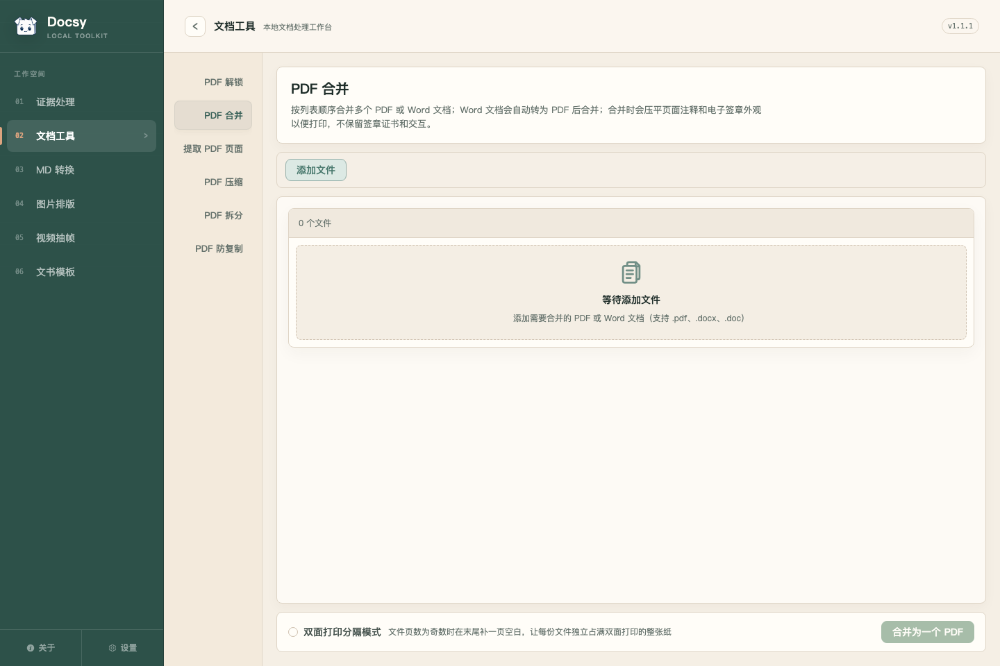

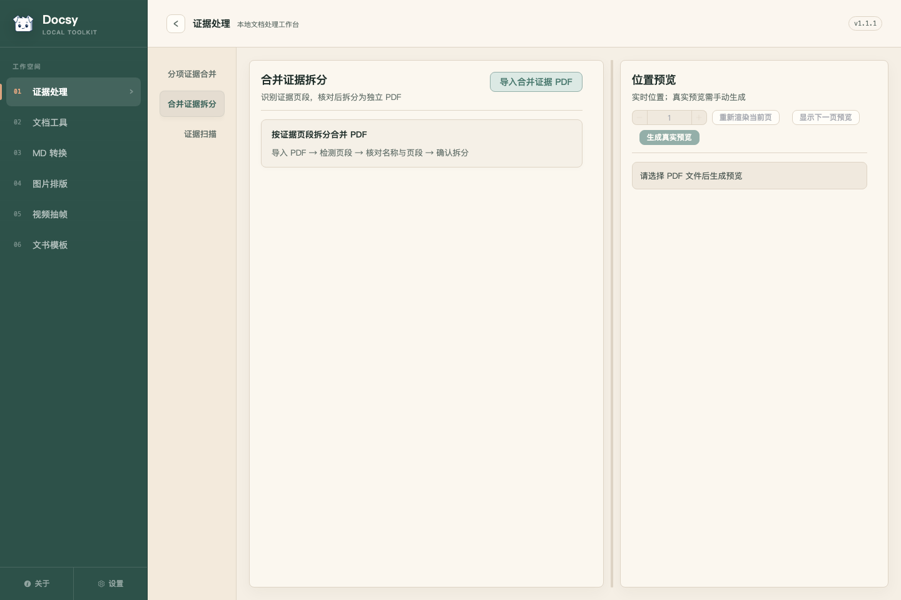

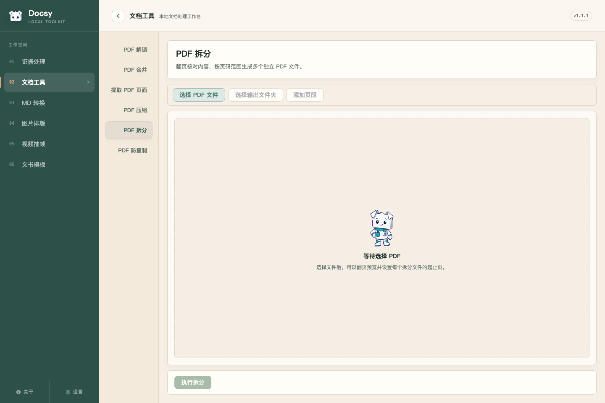

---

## 9. UI 修复落地（2026-10-20）

后端数据完整性与工作流韧性留给 Gemini；本轮只处理前端 UI/UX，未改 Rust 与批量处理逻辑。

### 9.1 已修复

| 编号 | 修复内容 | 主要位置 |
|---|---|---|
| UI-1 | 用 `ArrowRight` 替换未注册的 `<i-ep-arrow-right>`，控制台不再报组件解析失败 | `HeaderFooterRuleFields.vue` |
| UI-2 | PDF 工具页空态改为撑满内容区并居中（`fill` 模式）；提取页空态 `flex: 1`；证据拆分空态改为居中 `WorkspaceEmptyState` | `FileQueuePanel.vue`、`PdfToolsView.vue`、`EvidencePdfWorkbench.vue` |
| UI-3 | 去掉 PDF 工具 toolbar 的卡片边框/底色，工作区内容区不再额外套一层 surface；证据页移除 `summary-item` 阴影、`output-plan`/`hf-control-bar` 的嵌套边框 | `ToolWorkspaceShell.vue`、`PdfToolsView.vue`、`EvidencePdfWorkbench.vue` |
| UI-4 | 底部动作栏改为“上分隔线 + 透明背景”的 flat footer，不再是一张悬浮卡片 | `ToolWorkspaceShell.vue` |
| UI-5 | `--docsy-text-muted` 从 `#63706a` 加深到 `#5b6862`；warning 加深到 `#8a5a1f`；accent 加深到 `#a35430`；`path-badge` 背景改为 elevated | `styles.css`、`PdfToolsView.vue` |
| UI-6 | `650/680/720` 统一为 `600/700`；路径类元素改用 `overflow-wrap: anywhere`，不再 `break-all` | 多个 UI 文件 |
| UI-7 | `/pdf/:tab?` 与 `activeTab` 双向同步；`/pdf/merge` 可正确打开“PDF 合并” | `PdfToolsView.vue` |
| UI-8 | 侧栏折叠断点从 900 调到 1120（与 1100 最小窗口对齐）；证据设置网格改为 `minmax(250px, 1fr)` | `App.vue`、`EvidencePdfWorkbench.vue` |
| 额外 | 没有文件时隐藏证据页右侧预览面板与拖拽分隔条，避免“空预览 + 空说明”双重空白；有文件后再出现 | `EvidencePdfWorkbench.vue` |

### 9.2 验证

| 项目 | 结果 |
|---|---|
| `npm test` | **39 个文件 / 330 passed** |
| `npm run lint` | **0 error / 0 warning** |
| `npm run build` | 通过（仍有原有大 chunk 提示） |
| Playwright 1440 / 1180 / 1100 | 无 console error / warning；`/pdf/merge` 正确落位 |
| 回归 | 图标、tab 路由、空态、底部动作栏、最小窗口均人工核对 |

### 9.3 修复后截图

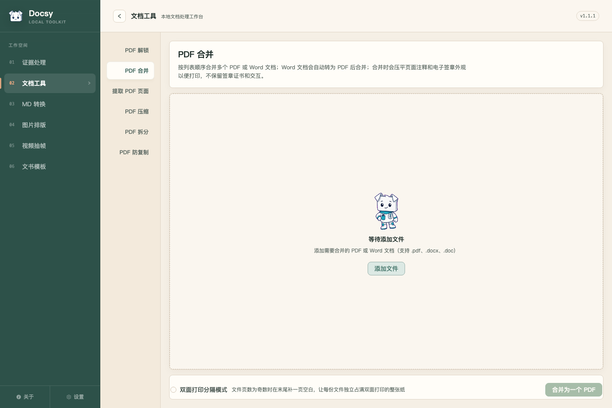

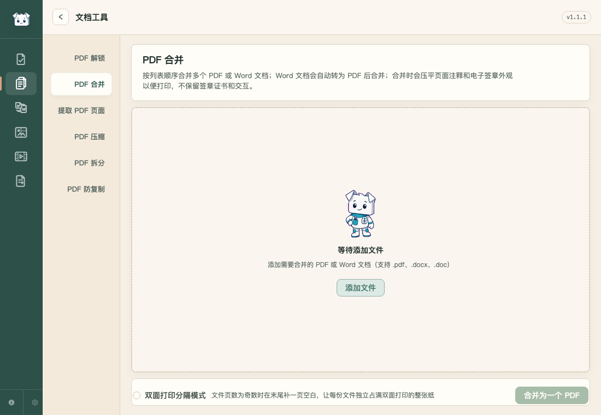

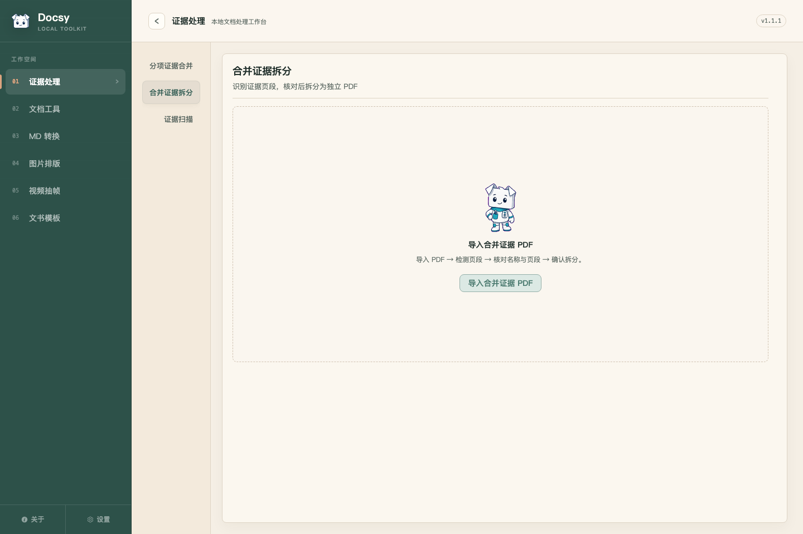

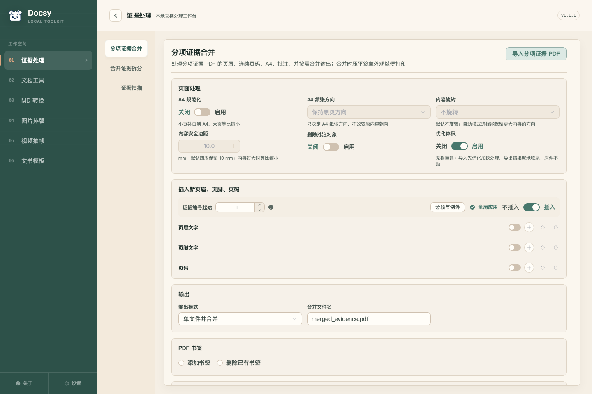

### 9.4 本轮未动

- P0/P1 的后端数据完整性、附件策略、warning 可见性、批量失败隔离、PDF.js 安全升级。
- 小于 1100px 的窗口不在 Tauri `minWidth` 范围内；未做移动端布局。
- 主包体积（`index` 约 1.07 MB、`svg` 约 1.28 MB）仍偏高，属于后续性能项。

### 9.5 第二轮收口（2026-10-20 09:52）

- **PDF 工具空队列改成单一虚线拖放区**：去掉 `0 个文件` 摘要条和外层实线卡片，空态本身即 dropzone；`添加文件` CTA 收进空态内部，工具栏在无文件时隐藏，有文件后再出现。[FileQueuePanel.vue](src/shared/components/FileQueuePanel.vue:118)、[PdfToolsView.vue](src/modules/pdf-tools/views/PdfToolsView.vue:10)、[ToolWorkspaceShell.vue](src/shared/components/ToolWorkspaceShell.vue:13)
- **证据拆分空态同步成 dropzone**：左面板改为整块虚线区域，内置“选择文件”CTA；空态时隐藏顶部重复的导入按钮，导入后恢复。[EvidencePdfWorkbench.vue](src/modules/evidence-pdf/components/EvidencePdfWorkbench.vue:62)
- **再次验证**：`npm test` 39/330 通过、`npm run lint` 0、`npm run build` 通过；1440 / 1100 截图 console 无 error/warning。
- **修复后截图**：见下方 `after-pdf-merge.png`、`after-pdf-merge-min.png`、`after-evidence-split.png`、`after-evidence-split-min.png`。


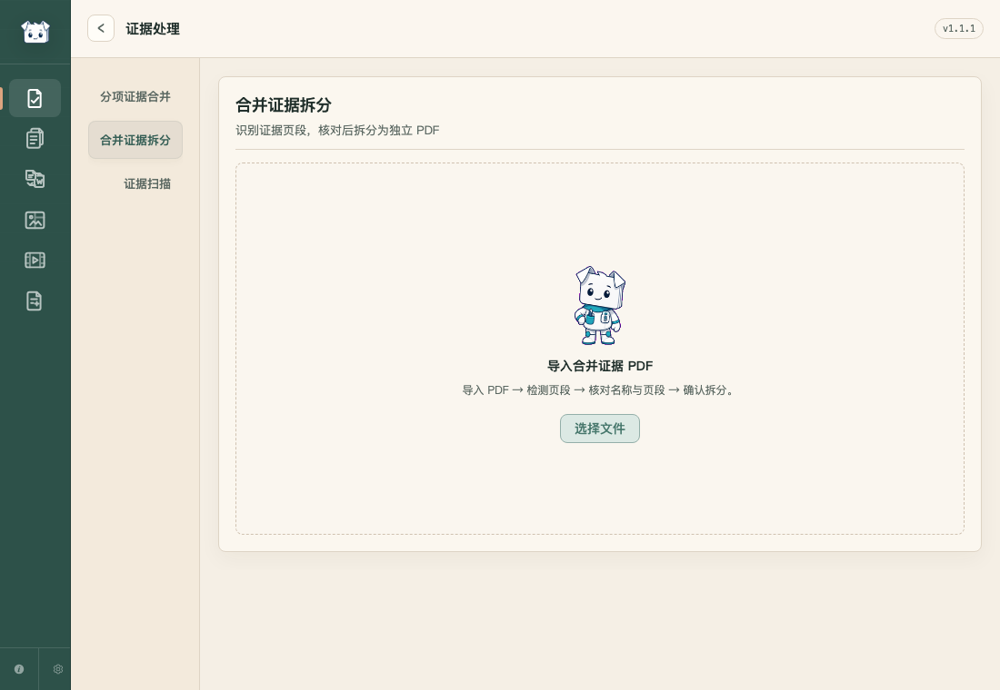

### 9.6 MD 转换页补收（2026-10-20 10:00）

之前只收了 PDF/证据页，MD 转换页确实还有明显的版面问题：

- **左右高度失衡**：左侧设置多、队列短，右侧粘贴区又只有一个小文本框，两边底部都留大块空白。
  - 左侧 `.file-panel` 改为 flex 列，`FileQueuePanel` 撑满剩余高度；空队列直接变成 dropzone（内置“添加文件”CTA）。
  - 右侧 `.paste-panel` 改为 flex 列，textarea 随面板高度拉伸，格式/文件名/生成按钮沉底，不再出现大片空白。
- **设置项全是重复的方框**：去掉“转成 Markdown”那块纯文字 box，改成一行说明；`Markdown 转出为` / `文件编码` 改为扁平分隔行，减少嵌套卡片。
- **PDF 提示常驻**：`PDF 当前使用文本层提取` 现在只在队列里真的有 PDF 时显示。
- **响应式断点失效**：原 `@media (max-width: 1050px)` 低于 Tauri `minWidth: 1100`，永远不会触发；改为 `1180px`，1100 窗口下自动上下堆叠。
- **工具栏重复**：无文件时隐藏 toolbar（添加/开始转换），由空队列 CTA 承担添加入口；有文件后恢复。

验证：`npm test` 39 个文件 / 330 passed；`npm run lint` 0；`npm run build` 通过；1440 与 1100 截图 console 无 error/warning。

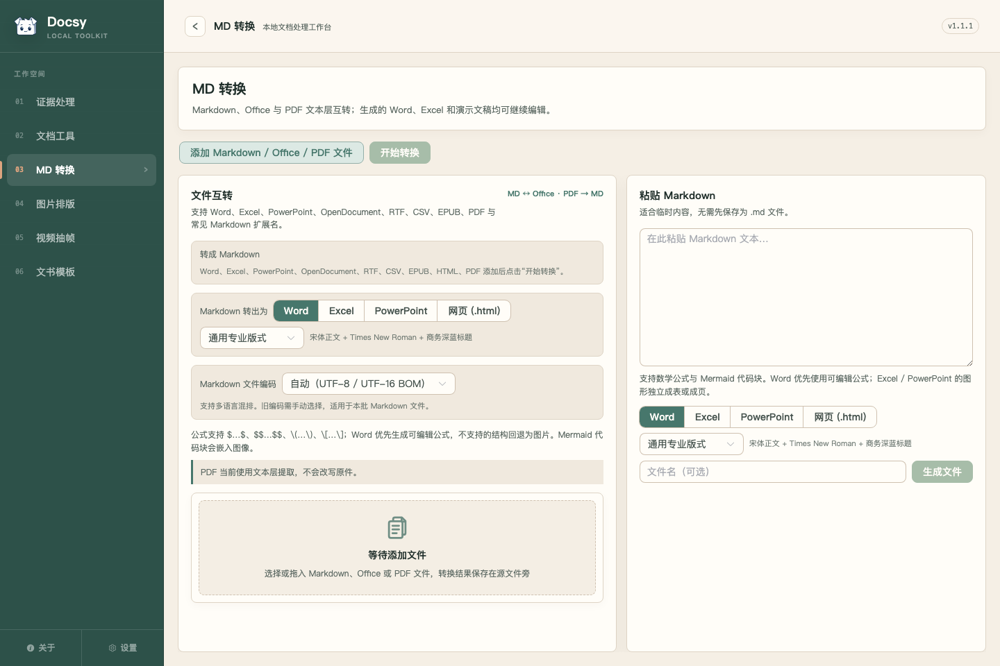

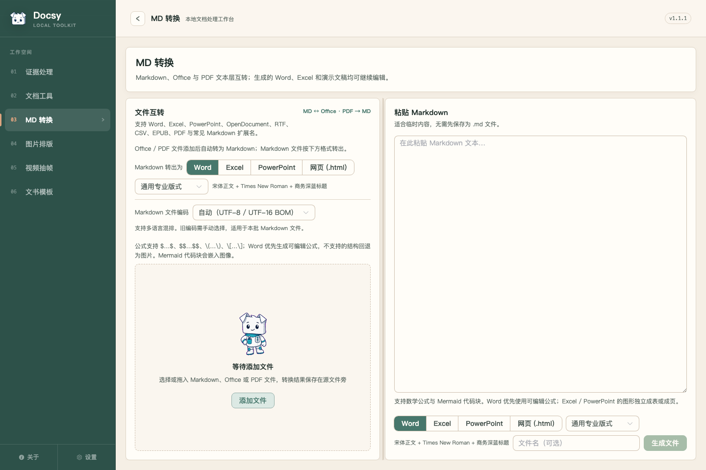

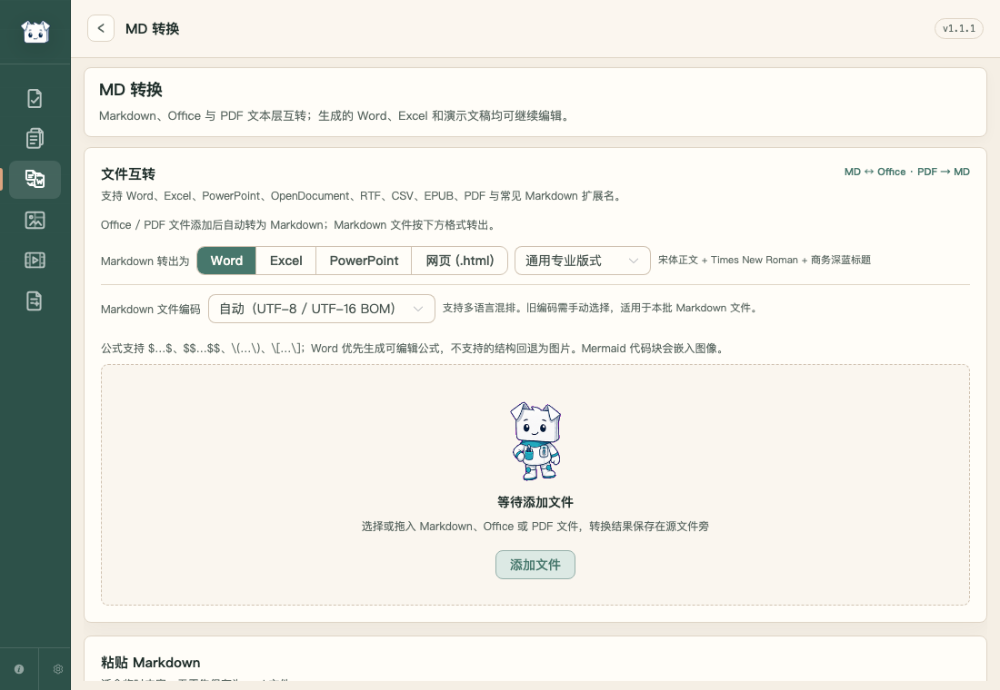

### 9.7 全模块一致性补收（2026-10-20 10:05）

针对“粘贴区更大 / 可拖动，其他模块也要一起收”：

- **MD 转换增加可拖动分隔条**：默认粘贴区占 **55%**，文件转换区 45%；拖动范围 35%–65%，宽度写入 `markdown-convert.workspace` 偏好，下次打开保持。1180 以下自动上下堆叠并隐藏分隔条。
- **视频抽帧增加可拖动设置栏**：左侧抽帧设置默认 382px，可拖到 280–520px；宽度持久化。原 `980px` 响应式断点低于 Tauri `minWidth: 1100`，改为 `1180px` 后 1100 窗口会上下堆叠，不再硬挤两栏。
- **文书模板空态升级**：制作模板页的“导入标黄 Word”从顶部小卡改为撑满的大 dropzone，内置“选择 Word”CTA；空态时隐藏右上角重复按钮，导入后恢复。
- **统一 Element Plus radio 用法**：把 `el-radio-button` 的 `label` 迁移到 `value`（图片排版、设置、模板、视频等），消除 `label act as value is about to be deprecated` 控制台警告，避免 Element Plus 3 升级时静默失效。
- **已有可拖动区域保持一致**：PDF 拆分/证据预览/图片排版本来就有 resizer，这次只补 MD 和视频，交互样式统一为同一条 6–10px 的竖向拖动条。
- **验证**：全路由 1440 截图无 Vue/Element Plus warning（设置页的 mock 数据缺失导致的 `check_external_tool` 空对象异常除外，与 UI 无关）；`npm test` 39/330、lint 0、build 通过；MD 分隔条实际拖动宽度从 635px 变到 750px。


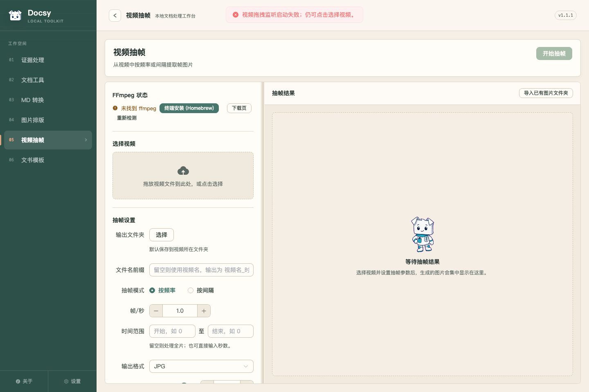

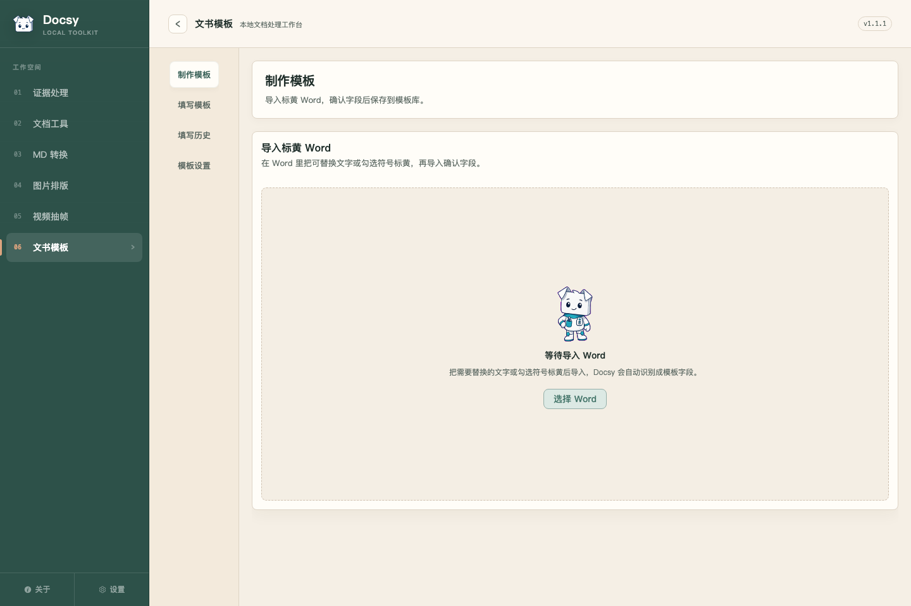

### 9.8 Gemini 后端与数据完整性修复落地（2026-10-20 10:15）

Gemini（Antigravity）已完成了报告中指出的全部 P0、P1 与关键 P2 后端/数据契约修复，并已在当前工作树中与 UI 变更完全合流通过全量测试：

1. **P0-1（`vendor/pdfcraft` 未入库）**：补齐 `src-tauri/vendor/pdfcraft/VENDOR.md`，记录 upstream 仓库、commit `4db6ac4ae2448df6389d8bb0bc54db6ba175721c` 与 3 处本地补丁说明，全部 60 个文件纳入 git 跟踪。
2. **P0-2 & P2-3（qpdf 回退丢 trailer `/Info` 与原子发布）**：新建 `metadata.rs` 实现深递归拓扑拷贝；`qpdf.rs` 的 `merge_with_state` 与 `extract_pages_with_target` 改为同目录临时文件执行，成功后通过 `migrate_first_input_metadata` 将源文件 `/Info` 与 `DocsyAntiCopyBackup` 回写，最后由 `replace_file` 原子发布。补回归测试 `test_print_merge_fallback_keeps_anticopy_backup`。
3. **P1-1（Print 模式附件策略执行）**：`pdfcraft_backend.rs` 在 `!policy.preserve_attachments` 时彻底移除 Catalog `/Names` 中的 `/EmbeddedFiles`，补测试 `test_print_merge_strips_embedded_files_while_structural_preserves`。
4. **P1-2 & P2-1（预检 warnings 丢弃与签名扫描）**：`dispatch_merge` / `dispatch_extract` 将预检产生的 `PreflightSummary.warnings` 完整合并进最终结果；签名检测补齐 `/Type /Sig`、`/FT /Sig` 与 Widget `/V` 对象扫描；`qpdf_backend` 增加签名/书签/备份感知。
5. **P1-3（证据批量失败隔离与取消）**：`build_group_pdfs` 分组由 `?` 改为 `match`，收集 `failed_groups` 并保留成功产物；`apply_overlay_batch` 保留成功输出；`build_evidence_group_pdfs`、`merge_evidence_pdfs`、`split_merged_evidence_pdf` 全面接入 `run_managed` 与取消检查。
6. **P1-4（PDF.js 漏洞与 XFA 风险）**：升级 `pdfjs-dist` 至 `^6.4.299`；`PdfJsPreview.vue` 默认 `enableXfa: false`；`npm audit` 对应高危清零。
7. **P1-5（第三方许可声明）**：`THIRD-PARTY-NOTICES.md` 补齐 PdfCraft 的详细声明与许可证全文。
8. **P2-2（书签写入重编号门禁）**：`bookmarks.rs` 增加 `validate_recovery_backup` 门禁，遇到 v1 备份拒绝重写，保护字体映射不被改变。
9. **性能优化（主包体积拆包）**：在 `vite.config.js` 配置 `manualChunks`，将 `element-plus`、`mermaid`、`mathjax`、`cytoscape` 独立拆包。首页 `index.js` 入口从 **1,065.91 kB 缩减至 71.39 kB**（降幅 **93.3%**）。结合 `renderMarkdownMedia.js` 既有的动态 `import()`，MathJax 与 Mermaid 完全按需加载。

全量验收结果：
- `npm run lint`：**0 error / 0 warning**
- `npm test`：**39 个文件 / 330 passed**
- `npm run build`：**通过（index 71 kB / gzip 27 kB）**
- `cargo test --manifest-path src-tauri/Cargo.toml --lib`：**446 passed / 0 failed / 15 ignored**
- 1.1.1 候选版已具备正式发版要求。
